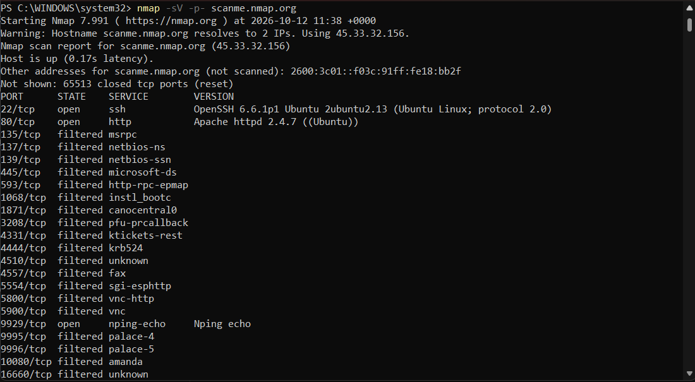
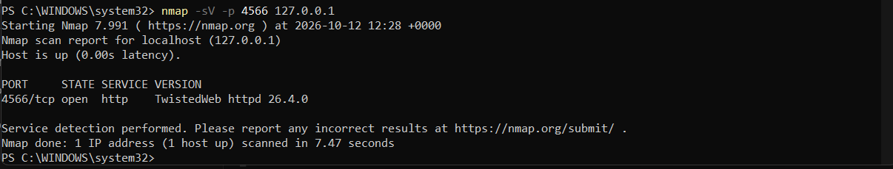
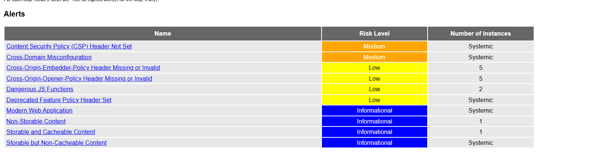
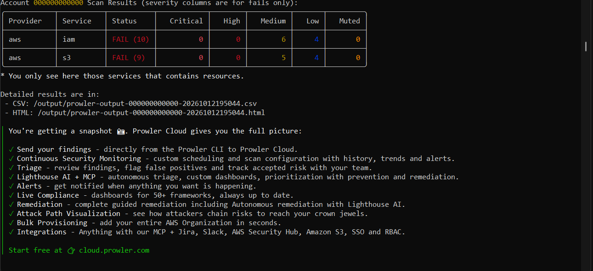

# Lab Sécurité Cloud
## Analyse des mauvaises configurations
**Otmane Arajdal** | 5e année Génie informatique | Option cybersécurité | 12 octobre 2026

J’ai réalisé ce lab pour comprendre ce qu’un service expose et comment ses paramètres peuvent créer un risque. J’ai travaillé sous Windows 11 avec PowerShell, Nmap 7.991 et Docker. Juice Shop, ZAP et Prowler 5.44.0 ont été utilisés en conteneurs, avec LocalStack pour simuler AWS. Les tests ont porté sur la cible autorisée scanme.nmap.org et sur mon laboratoire local.

## 1 Reconnaissance et analyse des ports

Le premier scan a indiqué les ports 22, 25, 80 et 443 ouverts sur 50.116.1.184. Les scans suivants ont utilisé 45.33.32.156 : la différence ne démontre donc pas une fermeture de ports sur une même machine. Le scan complet **nmap -sV -p- scanme.nmap.org** a testé 65 535 ports TCP en 788,29 s. Il a relevé 3 ports ouverts, 65 513 fermés et 19 filtrés.

| Port | Identification | Mesure proposée |
|---|---|---|
| 22 / SSH | OpenSSH 6.6.1p1 Ubuntu | Limiter l’administration aux accès autorisés et utiliser des clés. |
| 80 / HTTP | Apache httpd 2.4.7 | Public si prévu ; privilégier HTTPS pour les données sensibles. |
| 9929 / Nping echo | Service de test | Fermer ou restreindre s’il n’est pas nécessaire. |

Le scan ciblé **nmap -sV -p 4566 127.0.0.1** a ensuite trouvé HTTP / TwistedWeb 26.4.0. Docker publiait ce port sur la boucle locale : cela ne prouve pas une exposition à Internet. Un port filtré reste indéterminé, et une version détectée ne suffit pas à établir une vulnérabilité exploitable.

## 2 Analyse web avec ZAP

J’ai lancé le scan baseline de ZAP contre Juice Shop, sur le réseau Docker tp2-reseau, et conservé le rapport HTML dans un dossier Windows. L’exploration a découvert 116 URL. Le rapport contient **10 types d’alertes : 2 moyennes, 4 faibles et 4 informatives**, sans alerte élevée. Le baseline analyse passivement les réponses ; il ne couvre pas toutes les failles de l’application.

| Alerte et risque | Interprétation et correction |
|---|---|
| CSP absente / Moyen | Protection manquante contre certaines injections de contenu. Configurer Content-Security-Policy ; aucune XSS n’a été démontrée. |
| CORS permissif / Moyen | Access-Control-Allow-Origin: * relevé sur JS, CSS et robots.txt. Ces fichiers sont publics : aucune fuite privée n’est prouvée. Restreindre les origines si nécessaire. |
| Feature-Policy obsolète / Faible | Ancien en-tête observé. Le remplacer par Permissions-Policy avec des règles adaptées. |

## 3 Audit des configurations Cloud

L’installation Python a échoué au démarrage ; j’ai donc utilisé l’image Docker fonctionnelle. La variable **AWS_ENDPOINT_URL=http://localstack:4566** a dirigé l’audit vers le simulateur. Prowler a exécuté **73 contrôles** et produit **33 résultats : 14 PASS et 19 FAIL** en 16,1 s. Les FAIL se répartissent entre IAM (10) et S3 (9), avec 11 risques moyens et 8 faibles.

Pour S3, le versioning et la journalisation des accès sont désactivés. Pour IAM, la politique ne satisfait pas le seuil de 14 caractères demandé par la règle. Les corrections proposées sont d’activer la conservation des versions, prévoir des traces d’accès et renforcer la politique d’authentification. Le bucket est pourtant **privé et chiffré en AES256** : l’échec SSE-KMS concerne une exigence de gestion des clés, pas une absence de chiffrement.

Après un arrêt sans persistance, j’ai recréé le bucket. La vérification manuelle get-bucket-versioning n’a renvoyé aucun état activé, et get-bucket-encryption a indiqué AES256. Ce nouveau bucket présente les mêmes paramètres observés, mais ce n’est pas l’état original audité. L’AWS CLI décrit la configuration ; Prowler la compare à ses règles. Aucun script d’audit n’étant fourni dans le TP 1, cette comparaison porte sur ces deux commandes.

## 4 Analyse du scénario de compromission

Le scénario fourni est une analyse théorique, sans exploitation réalisée dans ce laboratoire. L’application accepte une URL et consulte les métadonnées à la demande de l’attaquant : c’est une SSRF. Les identifiants temporaires récupérés servent ensuite à explorer le stockage, avant le téléchargement de sauvegardes exposées.

| Étape | Responsabilité | Correction et détection |
|---|---|---|
| 1  SSRF | Client : application et destinations autorisées. | Contrôler adresses résolues et redirections ; limiter les sorties. Tests applicatifs ciblés avec ZAP. |
| 2  Identifiants compromis | Client : accès aux métadonnées et droits du rôle. Fournisseur : sécurité du service. | Exiger IMDSv2, protéger les métadonnées, réduire les droits. Audit Cloud des réglages ; surveillance des appels. |
| 3  Bucket public | Client : permissions du stockage. | Bloquer l’accès public et appliquer le moindre privilège. Prowler peut signaler cette exposition. |
| 4  Fuite des sauvegardes | Client : protection et surveillance des données. | Empêcher les lectures non autorisées, surveiller les volumes. Journaux et alertes de détection. |

Le pare-feu applicatif absent ne suffit pas à expliquer la SSRF : le traitement des URL est central. IMDSv2 ajoute une protection sans corriger toute SSRF. Le baseline ZAP exécuté ici n’a pas démontré cette attaque, et Nmap ne révèle que la surface réseau. Enfin, un bucket lisible anonymement permettrait de télécharger les sauvegardes sans les identifiants volés.

## 5 Bilan personnel et partage du laboratoire

Ce lab m’a surtout appris à vérifier ce que mesure chaque outil. Je ne peux pas assimiler un port ouvert, une alerte passive et une preuve de compromission. Le résultat CORS sur des fichiers publics et le chiffrement AES256 malgré le FAIL KMS illustrent cette différence. Les 19 FAIL sont des écarts aux règles, pas 19 attaques réussies ; certains contrôles dépendent aussi des limites du simulateur.

Pour partager le laboratoire sur GitHub, j’ai préparé une documentation des commandes PowerShell, les captures utiles et une synthèse des résultats. Les jetons, mots de passe, fichiers de configuration locaux et supports de cours ne doivent pas y figurer. Les recommandations de correction restent des propositions : je n’ai pas réalisé de campagne de remédiation ni de nouveau scan après correction.

## Références

- Support du module TP Séance 2 (non redistribué).
- [ZAP baseline](https://www.zaproxy.org/docs/docker/baseline-scan/)
- [ZAP CORS](https://www.zaproxy.org/docs/alerts/10098/)
- [Prowler](https://docs.prowler.com/)
- [AWS IMDSv2](https://docs.aws.amazon.com/AWSEC2/latest/UserGuide/configuring-instance-metadata-service.html)
